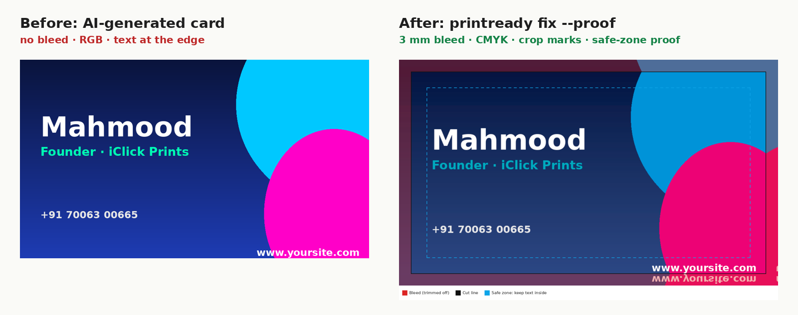
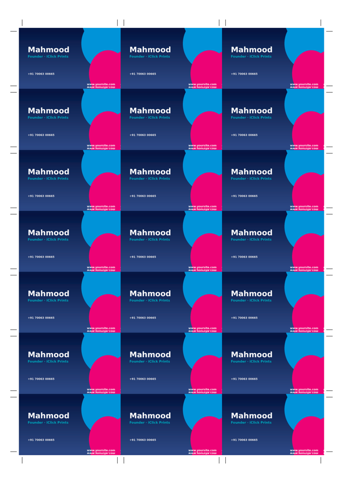

# print-ready

**Make any design print-ready from your AI assistant.** Claude, ChatGPT, Gemini, Cursor and Codex can design a
business card in seconds, but print shops reject most of those files: no bleed, wrong size, RGB colours,
low resolution, text too close to the edge, missing fonts.

`print-ready` fixes that. It's an **Agent Skill + MCP server + CLI** that preflights a design, explains every
problem in plain language, then produces a press-ready PDF: exact size, bleed, CMYK, crop marks,
TrimBox/BleedBox, plus a visual proof, n-up imposition for print shops and optional instant quotes.



```text
$ printready check ai-business-card.png -p business_card
 ! WARNING No bleed: the printer needs 3 mm of extra background on every side…   [auto-fix]
 ! WARNING About 34% of the design uses neon/very bright screen colours…
 ! WARNING Detail (text, lines or logo edges) was detected within 4 mm of the cut edge…
 i INFO    Artwork is RGB (screen colours); it will be converted to CMYK for print.
 ✓ OK      Resolution 292 dpi is good.
Verdict: NEEDS_ATTENTION

$ printready fix ai-business-card.png -p business_card --proof
Print-ready file: ai-business-card-print-ready.pdf
  ✓ added 3 mm bleed (mirror)   ✓ CMYK   ✓ crop marks + TrimBox/BleedBox
  Proof: ai-business-card-print-ready-proof.png
```

## Why

- AI-generated designs are everywhere; getting them **printed** is still a mess.
- Print shops spend their day fixing customer files by hand.
- Existing tools are pieces (a colour converter here, an Illustrator script there). This one runs the whole
  path from *"AI made my design"* to *"printer accepts it"*, inside the assistant you already use.

## Features

| | |
|---|---|
| **Preflight** | size & orientation, bleed, effective DPI, transparency, RGB/neon colours, ink coverage, safe-zone detail, unembedded fonts, image resolution inside PDFs, encrypted PDFs |
| **Fix** | fit to exact size (crop or pad), bleed by mirror/extend, CMYK (built-in GCR or your printer's **ICC profile** + output intent), crop marks, TrimBox/BleedBox, front+back, keeps already-correct PDFs as **vector** |
| **Inputs** | PNG, JPG, WebP, TIFF, PDF, **SVG and HTML** (what AI assistants usually produce) |
| **Proof** | PNG showing what gets trimmed (red), the cut line and the safe zone, returned as an image to the AI so it can show you |
| **Impose** | n-up layouts on A4, A3, SRA3, 12×18, 13×19 with cut marks; duplex backs mirrored for work-and-turn |
| **Products** | 27 presets: visiting cards (IN/US/EU), flyers, brochures, letterheads, posters, roll-ups, flex banners, stickers, T-shirts, mugs, photos, or any custom size |
| **Quotes** | optional instant price quotes through [PrintQuote](https://printquote-mcp.aiemailgenie.workers.dev) |



## Install

You need Python 3.10+. The quickest path is [uv](https://docs.astral.sh/uv/):

```bash
uvx --from git+https://github.com/sharikwani/print-ready printready --help
# or install it
pip install "git+https://github.com/sharikwani/print-ready"
# optional: HTML/SVG rendering
pip install "print-ready[render] @ git+https://github.com/sharikwani/print-ready" && playwright install chromium
```

## Use it with your AI

### Claude Code (plugin: skill + MCP server)

```
/plugin marketplace add sharikwani/print-ready
/plugin install print-ready@print-ready
```

### Claude Desktop, Cursor, Windsurf, Gemini CLI, Codex… (MCP)

Add to your MCP config (`claude_desktop_config.json`, `~/.cursor/mcp.json`, `~/.gemini/settings.json`, …):

```json
{
  "mcpServers": {
    "print-ready": {
      "command": "uvx",
      "args": ["--from", "git+https://github.com/sharikwani/print-ready", "printready", "mcp"]
    }
  }
}
```

For quotes, add `"env": {"PRINTQUOTE_MCP_URL": "https://…/mcp/pq_…"}` (free key at
[PrintQuote](https://printquote-mcp.aiemailgenie.workers.dev)).

Remote clients (ChatGPT developer mode, web agents) can use the HTTP transport:
`printready-mcp --http --host 0.0.0.0 --port 8000` → `http://your-server:8000/mcp`.

### Agent Skill only (Claude.ai, Claude Code, Codex, any skills-compatible agent)

Copy [`skills/print-ready`](skills/print-ready) into your skills folder (e.g. `~/.claude/skills/`),
or upload it as a zip in Claude → Settings → Capabilities → Skills. The skill drives the CLI.

Then just ask:

> *"Design a visiting card for Sharma Printers and make it print-ready."*
> *"Is this flyer OK to print as A5? Fix it and show me the proof."*
> *"Put 21 of these cards on an SRA3 sheet for my press."*

### MCP tools

| Tool | What it does |
|---|---|
| `list_print_products` | products with trim, bleed, safe zone and pixel sizes |
| `design_spec` | exact numbers to design at (mm, px, CSS px) + design rules |
| `preflight_check` | full report with plain-language fixes |
| `make_print_ready` | build the print PDF |
| `make_proof` | proof image (returned to the model) |
| `impose_sheet` | n-up press sheet |
| `get_print_quote` | itemised price + shareable quote link |

## CLI

```bash
printready products [--category cards]
printready check FILE -p PRODUCT [--json]
printready fix FILE [BACK] -p PRODUCT [--proof] [--icc profile.icc] [--no-marks] [--fit contain] [--bleed-mode extend] [--jpeg 92]
printready fix art.png --width 100 --height 210            # custom size in mm
printready proof print.pdf
printready impose print.pdf --sheet sra3
printready quote -p business_card -q 500 --double-sided
printready mcp                                              # stdio MCP server
```

`check` exits 0 when ready, 1 when there are issues, 2 on errors, so it works in CI and scripts.

## Honest limits

- Without your printer's ICC profile, CMYK conversion uses a neutral grey-component formula: safe and
  predictable, not colour-exact. Ask your printer for their profile (ISO Coated v2 / FOGRA39, GRACoL…)
  and pass `--icc`.
- The safe-zone check is a heuristic; always look at the proof.
- PDFs that need fixing are rasterised at print resolution (vector is kept when the PDF is already correct).
- Spot colours, foil/varnish layers and die-cut paths aren't generated.

## Development

```bash
pip install -e ".[dev]"
pytest          # 42 tests: preflight, build, colour, imposition, CLI, MCP
ruff check src tests
```

Ideas and PRs welcome: more product presets (send your print shop's spec sheet!), printer integrations,
Pantone/spot-colour support, PDF/X validation.

## License

MIT © iClick Solutions
